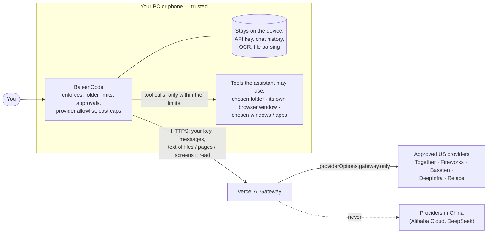
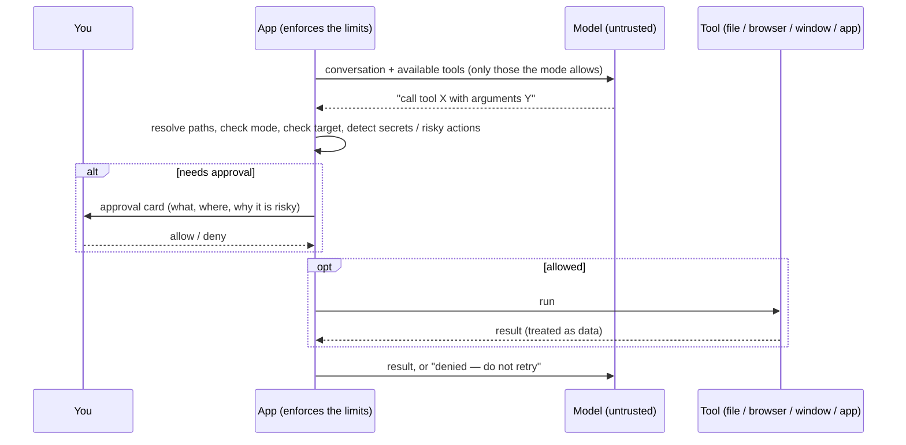

# Threat model

This document says what the app protects, against whom, with which controls, and what is left over. It is written for
people who want to judge the design rather than take it on trust. Every control below is either enforced in code and
covered by an automated test ([docs/TESTING.md](TESTING.md)), or explicitly marked as depending on the model's behaviour.

## What is being protected

| Asset | Why it matters |
|---|---|
| Your Vercel API key | Lets someone spend your credits |
| Your files and what is on your screen | Private data the assistant is allowed to look at |
| Your logged-in accounts | A browser, window or phone app the assistant drives may be signed in |
| Your device | The assistant can change files, run commands (Windows Full access) and press buttons |
| Where your text is processed | Chosen providers only; never a provider in China |

## Data flow and trust boundaries

Everything the model *reads* ends up at the providers; everything the model *does* passes through the app, which is
the only place where limits are enforced. The model is untrusted: it is treated as a component that can be wrong or be
manipulated, never as a security boundary.

### One agent step

## Who or what the design defends against

1. **Malicious content** in a file, web page, window or app screen that tries to steer the model (indirect prompt injection).
2. **A model that errs** — deleting the wrong file, clicking the wrong button, running too long.
3. **A website** that tries to reach the local server in the background (cross-site requests, DNS rebinding).
4. **A malicious or careless provider** — mitigated by the allowlist and by choosing providers that report zero data retention.
5. **Hostile files** (zip bombs, oversized images, PDFs with scripts) aimed at the parsers.

Not defended against: malware that already runs as you, someone with access to your user profile or unlocked device, and
vulnerabilities in the operating system, the browser or the providers.

## Controls, against the OWASP list

The [OWASP Top 10 for LLM Applications (2026 edition)](https://genai.owasp.org/2026/09/01/owasp-genai-security-project-unveils-2026-top-10-for-llm-applications-new-agent-control-standard-and-sponsors-as-community-tops-30000-members/)
is used here as a checklist. Names are used rather than numbers, because secondary sources number a few entries differently.

| Risk | What the app does | Residual risk |
|---|---|---|
| **Prompt injection** | Tool output, file text, page text and screen text are labelled as data in the system prompt; the model is told to report and ignore instructions found there. Planted instructions on a test page and in a test file were ignored and reported. | This is model behaviour, not a guarantee. The design assumes it can fail — see *Excessive agency*. |
| **Excessive agency** | Seven modes, each with a fixed tool set (read-only mode has no write tools; commands exist only in Full access). Folder limits are resolved in code (symlinks and junctions included). Delete moves to a trash folder; overwrites are backed up. Three approval levels (ask every time / auto-accept edits / autonomous); at every level secrets, password fields, purchase/delete/send buttons, long-query URLs and risky commands (formatting, permanent deletes, `git push`, process kills, data uploads) **always** ask. In `/goal` runs an unanswered approval is skipped, never granted. Desktop/phone modes touch only the windows/apps you named. | At the Autonomous level a manipulated model can edit and delete inside the allowed scope (recoverably) and, in Full access, run commands that are not on the list. A command list cannot catch every harmful command. |
| **Reading web pages (with web search on)** | Fetched from the user's device, GET only, no cookies; private, loopback and local-network addresses refused (checked on the resolved address, again after each redirect); China's country domains refused; addresses with long query strings or over 300 characters ask first, because a page could tell the model to put private data into an address. Page text is marked as untrusted data. | A short address can still carry a little data out; keep web search off for sensitive folders. |
| **Web search (optional)** | Off by default; a confirmation explains where the search words go. Only search words leave for Parallel (US) through Vercel; the system prompt tells the model not to put private details from files or pages into a query, and treats results as untrusted data. | A misled model could still put something private into a query; keep it off for sensitive folders. |
| **Sensitive information disclosure** | Keys, `.env`, browser profiles, credentials and similar paths always ask before being read. The API key never goes into the model's context. Content is not logged. | Whatever the assistant reads is sent to the providers. Files you hand it, it can read. |
| **Supply chain** | One runtime dependency (`pdfjs-dist`, pinned), no remote code, no telemetry, page loads only its own files (Content-Security-Policy). `package-lock.json` is committed. | The Windows package bundles Node.js; the Android app bundles Google ML Kit (see [THIRD_PARTY_NOTICES.md](../THIRD_PARTY_NOTICES.md)). Models are third-party. |
| **Unbounded consumption** | A per-request cost cap you set (0.1–5 USD) that also ends `/goal` runs, 30 steps outside goals, a time limit for goals (default 8 h, at most 24 h); 429 retries are bounded; size limits on files (100 MB), PDF pages (1,000) and conversations. | Your Vercel budget is the real backstop — set one. |
| **Improper output handling** | Model text is inserted into the page as text, never as HTML; tool output is shown in `<pre>`; arguments are validated; PowerShell arguments are passed encoded. | Commands you approve are executed as written. |
| **Hidden context exposure** | The system prompts are plain text in the source; they contain no secrets. | n/a |
| **Misinformation** | Not addressed by code. | Check anything that matters. |
| *Data/model poisoning, vector weaknesses* | Not applicable (no training, no retrieval store). | — |

## Controls by mode

| Mode | Reach | Asks first (when recognised) | Enforced by |
|---|---|---|---|
| Read-only / Read & write (folder) | One folder | Secrets; deletes | Path resolution in the server (Windows); the system folder picker (Android) |
| Full access (Windows) | Whole PC as you | Secrets and risky commands at every level; other actions per the approval level | Tool gating and approvals in the server |
| Browser (text / screenshots) | Windows: its own Edge/Chrome window with a separate profile. Android: a separate web view panel with no bridge to the app, https only | Purchase/delete buttons, password fields | DevTools protocol on one window (Windows); a web view without a JavaScript interface, file or content access (Android) |
| Desktop apps (Windows) | Windows whose titles you typed (up to 5) | Risky buttons, password fields | UI Automation on matched windows only; stale controls are refused |
| Phone apps (Android) | Apps you picked (up to 5) | Risky buttons, password fields | Accessibility service bound to the chosen packages; the app's own package is refused |
| Phone apps · screenshots (Android) | Apps you picked (up to 5), by screen position | Taps whose point lies on a risky control or a password field | Each tap / swipe point must lie on a chosen app's top window (checked against the window layers); otherwise refused |

## The local server (Windows)

Listens on `127.0.0.1` only. Requests whose `Host` header is not `localhost`/`127.0.0.1` are refused (DNS rebinding), as are
requests with a foreign `Origin` or a cross-site `Sec-Fetch-Site` (other websites). Request bodies are size-capped. The API
key travels in a header from the page and is never written to disk by the server.

## Residual risks, in one list

1. Prompt injection is mitigated, not solved; approvals are the real defence.
2. The Autonomous level, long `/goal` runs and Windows Full access are powerful by design.
3. The API key is stored unencrypted on the device.
4. Everything the assistant reads goes to the providers.
5. A program already running as you can talk to the local server.
6. Third-party components (providers, models, Node.js, ML Kit, the OS) are outside this project's control.
